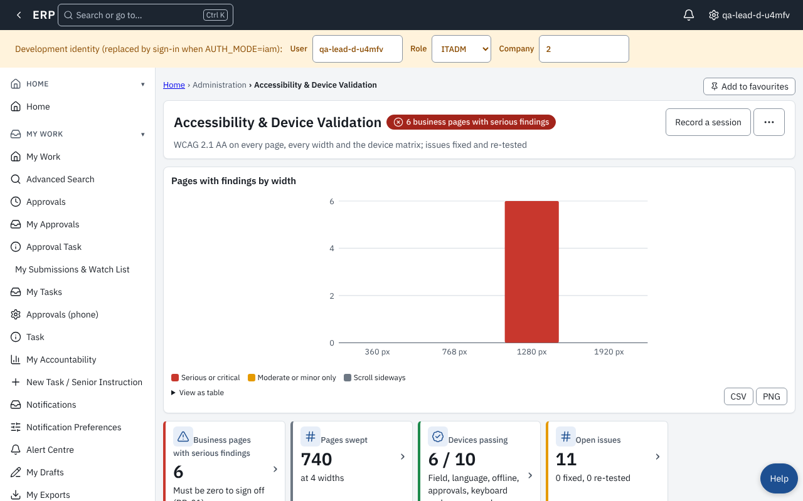
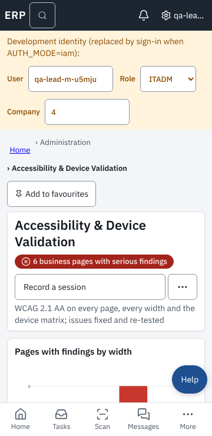

# Part 30.07 — Accessibility, Responsive & Device Validation

Execution step 225 · 2026-11-23 · Branch `ccr-a3b3ce3d-65llwf` · **Ready for review**: built and tested behind `ff.qa.p3007`. The automated part is complete. Real handsets, Firefox/Safari and real screen-reader sessions are recorded by hand during UAT (D-165).

## 1. Discovery

There was an axe spec over about ten key pages, responsive checks at 360/768/1280, offline and field journeys, and Chromium-only Playwright projects. Nothing kept results, issues or a sign-off. See the [discovery note](../DISCOVERY/30.07.md).

## 2. What was built

**FR-01 Device and browser matrix** (`tst_devices`, ADR-768): ten rows.

- Six are emulated in Chromium on every run:
  - low-end Android: 360 × 640, CPU 6× slower, Slow 3G;
  - mid-range Android: 4× CPU, Fast 3G;
  - iPhone SE size with its user agent;
  - a 10-inch tablet;
  - desktop at 1280 and 1920.
- Four are completed by hand: a real Android, a real iPhone, Firefox, Safari.

**FR-02 FR-03 Sweeps** (`e2e/tst-a11y-sweep.spec.js`):

- Every registered page is opened in a company with every feature on, by a user holding every internal role.
- It records axe findings against WCAG 2.1 A and AA, sideways overflow, touch targets under 44 px and inputs under 16 px (on a phone), the load time and errors.
- Results are posted to the validation results and kept in `docs/erp/a11y/a11y-<width>.json`.

**FR-01 FR-02 FR-03 Device journeys** (`e2e/tst-device-matrix.spec.js`) run on each emulated device with its CPU and network throttling:

- field home → DPR entry in at most two taps;
- the field home in Hindi and in Telugu;
- offline banner on and off;
- the approvals inbox;
- the screen-reader tree: landmarks, one h1, every button named;
- keyboard focus and the command palette (desktop).

**FR-04 Fix and re-test.** Each failing page or journey is an issue. It is marked fixed with the commit and closed by the next passing run of the same check, width and device.

**BR-01 and the sign-off (ADR-767).**

- The verdict counts serious and critical findings on business pages only; the administration consoles are listed but do not block.
- The UX lead (SYSADM) asks for the sign-off; the QA lead (ITADM) signs through the approval engine.
- The sign-off is refused while a business page is blocked.

**Page: Accessibility & Device Validation Results** (`/admin/accessibility-validation`)

- Chart first: findings by width.
- Key figures: pages swept, blockers, issues open, fixed and re-tested, devices passed.
- The device matrix with its last run, the screen-reader sessions, and a form to record a session by hand.
- The results with parameters (kind, width, issue state, search) and the issue panel.
- Exports.

## 3. Results (2026-11-23, after the fixes)

| Sweep | Pages | Serious / critical | All findings | Overflow at the width | Small targets / tiny inputs (phone) | Load errors |
|---|---|---|---|---|---|---|
| 360 px, axe | 738 | **0** | 0 | 0 | 0 / 0 | 5 (see below) |
| 768 px | 739 | — | — | 0 | — | 0 |
| 1280 px, axe (first run) | 738 | 7 critical on 6 pages | 7 | 0 | — | 0 |
| 1280 px, re-test of the 6 pages after the fix | 6 | **0** | 0 | 0 | — | 0 |
| 1920 px | 740 | — | — | 0 | — | 0 |

**Fixed (FR-04).** Commit "Parts 30.07-30.09 (work in progress)". Each row is the page, then the finding and its fix:

- `/training`: the month grid had cells directly under the grid. It is now rows of seven (`aria-required-children` / `aria-required-parent`).
- `/training/compliance`, `/plan/weekly`, `/bill/deviations`, `/bill/vendor-invoices`: buttons, links or a search box sat inside `role="tablist"`. The tabs now have their own list; the other controls sit beside it.
- `/inv/scrap`: links marked as tabs became a `nav` with `aria-current`.

**Load errors.** At 360 px, 5 pages did not render their `main` inside the time limit during the sweep (`/hr/crews`, `/hr/crews/crew`, `/proj/baseline-pack`, `/proj/wbs`, `/proj/work-packages`). They load at 768, 1280 and 1920 px. Re-tested at 360 px with `A11Y_ROUTES` on the rebuilt client: all five open, with no finding, no overflow and no small target (`docs/erp/a11y/retest/a11y-360.json`).

**Coverage check.** The 360 and 768 px runs ended with coverage 99.7 % and 99.8 % instead of 100 %. Two routes (the documentation library, and the operations page moved off a route already taken) were added while those runs were going, and the server reads the registry live. Their results are complete for the pages they opened.

## 4. Tests

| Test | Result |
|---|---|
| `tests/tst-a11y.test.js` (4): routes validated against the registry; a serious finding fails the page; the re-test closes issues of the same kind, width and device; the verdict counts business pages only; the sign-off refused while blocked, signed by another person; roles; export | pass |
| `e2e/tst-a11y-sweep.spec.js` at 360, 768, 1280, 1920 px | results above |
| `e2e/tst-device-matrix.spec.js` (six emulated devices) | pass: every journey PASS on android-low, android-mid, iphone-se, tablet-10, desktop-1280 and desktop-1920 (field DPR in two taps, Hindi, Telugu, offline and back, approvals, screen-reader tree; keyboard on the desktops); `docs/erp/a11y/devices.json` |
| `e2e/tst-golive-docs.spec.js` (desktop and mobile): the sweeps and journeys loaded into a company, a screen-reader session recorded, the page and its screenshots, the sign-off asked and signed when the verdict is clear | pass (desktop and mobile, 2026-11-23) |
| `tests/integrity.test.js` (the device matrix is installation-wide), lint, typecheck, route check, permission audit, migration check, schema-diff | pass |
| Full regression of this batch (2026-11-23): `node --test tests/*.test.js` | pass: 1,736 tests, 0 failed |

## 5. Acceptance criteria

| Criterion | Status | Evidence |
|---|---|---|
| T-01 axe zero serious/critical; device matrix journeys pass | Met for the automated part | §3: 0 serious or critical at 360 and 1280 px after the fixes. Every device journey passes on the six emulated devices (`docs/erp/a11y/devices.json`). |
| AC-01 report signed with all issues resolved | Partly | The sign-off is asked and signed on the page in the e2e company. The real UX and QA leads sign the release report after the manual sessions of UAT (D-165). |
| AC-02 … AC-07 | Met | Page checklist; roles (`tests/tst-a11y.test.js`); sign-off by another person; tests; this report; screenshots. |
| AC-08 owned defects | Met | D-165 (narrowed) and D-804 re-assigned to 30.10 with their reasons. |

## 6. Data changes

- Migration `20261228000424_tst_a11y`: `tst_devices` (ten seeded rows, installation-wide), `tst_a11y_runs`, `tst_a11y_results`; navigation and tracker row.
- Permissions `tst.a11y.view`, `tst.a11y.record`, `tst.a11y.signoff`, `tst.a11y.export` (ADR-767).

## 7. Screenshots

## 8. How to verify manually

1. Turn on `ff.qa.p3007`.
2. Run the sweeps for 360 and 1280 px:
   `A11Y_WIDTH=360 npx playwright test e2e/tst-a11y-sweep.spec.js --project=mobile`
   `A11Y_WIDTH=1280 npx playwright test e2e/tst-a11y-sweep.spec.js --project=mobile`
3. Run the sweeps for 768 and 1920 px without axe (add `A11Y_AXE=0` to the same command).
4. Run the device journeys: `npx playwright test e2e/tst-device-matrix.spec.js --project=mobile`.
5. Open **Admin › Accessibility & Device Validation**: no business page is blocked.
6. Record an NVDA session with **Record a session**. As SYSADM ask for the sign-off; as ITADM sign it.
