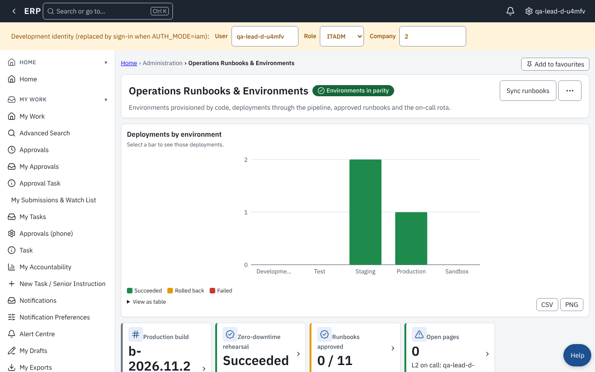
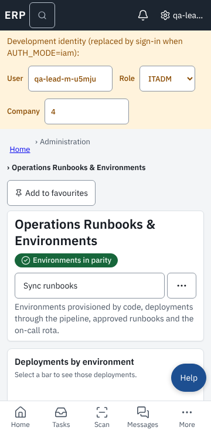

# Part 30.08 — DevOps, Environments, Deployment & Operations Runbooks

Execution step 226 · 2026-11-23 · Branch `ccr-a3b3ce3d-65llwf` · **Ready for review**: built and tested behind `ff.qa.p3008`. The container image is defined and built in CI only; it was not built in this environment (no Docker daemon, D-815).

## 1. Discovery

The repository had an artefact packager and an in-place deploy and rollback to a directory environment (00.03), metrics, alert rules and alerts (01.07), and backups, restore tests and DR drills (29.06). It had no container, no infrastructure code, no blue-green deploy, no runbooks, no on-call rota and no environment inventory. See the [discovery note](../DISCOVERY/30.08.md).

## 2. What was built

**FR-01 Environments as code**

- `Dockerfile`: multi-stage on `node:24-bookworm-slim`, runs as `node` under tini, with a health check. `.dockerignore` keeps data and secrets out.
- `docker-compose.yml`: the blue slot (3301), the green slot (3302, profile `deploy`) and nginx. The secrets are required from the vault (`${AUTH_SECRET:?…}`). Logs: json-file, 50 MB × 10 per container (FR-03 retention).
- `infra/environments/{dev,test,staging,production,sandbox}.env`: the same keys in every environment, no secret, only the allowed differences.
- `infra/ansible/site.yml` and `inventory.ini`: host provisioning (Docker, users, firewall, log rotation, the stack).
- `infra/nginx/erp.conf` and `active-upstream.conf`: TLS, the proxy and the slot include written by the deploy.
- `scripts/env_parity.mjs` (`src/server/modules/tst/envparity.js`): same keys, no secrets, allowed differences, and each file accepted by the application's own configuration loader. It runs in CI and on every load of the page.

**FR-02 Blue-green deploy, migrations, rollback** (`scripts/lib/bluegreen.mjs`, `scripts/deploy.mjs --blue-green`, `scripts/rollback.mjs --blue-green`)

1. The artefact is checked against its SHA-256 sums.
2. A verified restore point is taken (VACUUM INTO, integrity check, table counts).
3. Migrations run (as a child process, so traffic keeps flowing).
4. The new build starts on the idle slot and must pass the smoke test (health, about page with the expected build).
5. The switch is one write of the state file and the nginx include; the old slot drains and keeps running, so a rollback is a switch back.
6. On a failure the migrations are undone by their down scripts or, failing that, by the restore point; the serving build is untouched.

**FR-03 Monitoring and on-call**

- `infra/monitoring/alerts.yml` (ErpDown, ErpServerErrors, ErpSlowLists, ErpMemoryHigh, ErpBackupStale, ErpDeadLetters, ErpJobsBacklog, ErpDiskLow, ErpCertificateExpiring) — every metric they use is exported by `/metrics` (a backup-freshness gauge was added) — and `alertmanager.yml`.
- In the application, every fired alert (`core.alert.fired`) pages the person on shift: critical → L2, warning → L1, by in-app, SMS and e-mail. Nobody on shift → the page is UNCOVERED and shown in red.
- The job `ops.oncall.escalate` (every 5 minutes) escalates a page not acknowledged within `ops.oncall.ack_minutes` (15) to the next level. Acknowledging the page acknowledges the alert.

**FR-04 FR-05 Runbooks and support model** (`docs/erp/runbooks/`): deploy, rollback, restore, scale, rotate secrets, certificate renewal, incident response, period-end support, payroll-day support, environments and the support model (L1 help desk, L2 application team, L3 vendor; S1 15 min / 4 h, S2 1 h / 1 day, S3 1 day / 5 days; availability 99.5 %; RPO 15 min, RTO 4 h). They are synced into the application by content hash, submitted by DevOps and approved by the system administrator (never by the submitter). A changed file becomes a new draft version.

**BR-01 Production only through the pipeline**: a production deploy or rollback is recorded only by the pipeline's service account (`pipeline:…`) with its run and the artefact's SHA-256; a person's record is refused (403). The CI job `deploy-rehearsal` runs the parity check and the zero-downtime rehearsal on every push; `container-scan` builds and scans the image.

**Page: Operations Runbooks & Environments** (`/admin/operations-runbooks`; `/admin/operations` is the 01.04 console)

- **Header:** parity of the environments.
- **Chart first:** deployments by environment and outcome; each bar opens those deployments.
- **Key figures:** the production build and slot, the last zero-downtime rehearsal (requests, failed), runbooks approved, open pages and who is L2 now.
- **Tabs:**
  - environments and deployments (cards on a phone, parameters in a bottom sheet, sticky totals, export);
  - runbooks (read, submit, approve);
  - on call (who is on shift, pages with acknowledgement, the rota and a form to add shifts).

## 3. Rehearsal (T-01)

`node scripts/rehearse_zero_downtime.mjs` (evidence `docs/erp/perf/zero-downtime.json`, 2026-11-23). Eight clients called the health check and the about page through the switching proxy every 25 ms during every step.

| Step | Result |
|---|---|
| Deploy build A (first deploy, blue) | PASS, 5.8 s |
| Deploy build B with an extra migration to green and switch, under traffic | PASS, 1,476 requests, 0 failed, builds A → B |
| Roll back to A, under traffic (B's migration undone by its down script) | PASS, 354 requests, 0 failed, builds B → A |
| Drill: a build whose migration fails | PASS, A kept serving, the migration undone, 52 requests, 0 failed |
| Drill: a build that does not start | PASS, A kept serving, 1,466 requests, 0 failed |
| Zero failed requests through every switch | PASS, 3,348 requests, 0 failed |

## 4. Tests

| Test | Result |
|---|---|
| `tests/ops-devops.test.js` (5): environments as code and parity, compose and alert metrics; BR-01 deployments; rehearsal record; runbooks versioned and approved by another person; on-call paging, escalation and acknowledgement, roles, export | pass |
| `tests/ops-zero-downtime.test.js` T-01 (the rehearsal above, about 25 s) | pass |
| `e2e/tst-golive-docs.spec.js` (desktop and mobile): the page with the rehearsal, a pipeline deploy, BR-01 refusal of a person's production record, runbooks approved on the page, the rota | pass (desktop and mobile, 2026-11-23) |
| `tests/api.test.js`, `tests/config-core.test.js` (the new permissions and parameter) | pass |
| lint, typecheck (0 errors), route check, permission audit, migration check, schema-diff, db-lint | pass |
| Full regression of this batch (2026-11-23): `node --test tests/*.test.js` | pass: 1,736 tests, 0 failed |

## 5. Acceptance criteria

| Criterion | Status | Evidence |
|---|---|---|
| AC-01 environments provisioned by code; deploy and rollback rehearsed; runbooks approved | Partly | Code and parity: §2. Rehearsal: §3, also in CI. Runbooks approved in the application (e2e approves the deploy runbook). Not done here: the image build and the provisioning of a real host (D-815, D-009). |
| AC-02 page completion checklist | Met | No placeholder, every figure from the API, empty and error states. |
| AC-03 roles | Met | ITADM all `ops.*`; SYSADM approves runbooks and acknowledges pages; AUD reads; others 403 (`tests/ops-devops.test.js`). |
| AC-04 configuration changes audited and maker-checker | Met | Runbook versions through the approval engine; `ops.oncall.ack_minutes` under the 29.01 parameter maker-checker; every write audited. |
| AC-05 tests and regression | Met | §4 and the full regression of this batch. |
| AC-06 this report | Met | |
| AC-07 UI v3 and phone | Met | Screenshots below; no sideways scroll at 360 px, cards, bottom sheet, 125 % text in the dark and high-contrast themes. |
| AC-08 owned defects | Met | D-110 closed (Dockerfile; the scan job no longer skips). The other 26 re-assigned to 30.10 with their reasons in `DEFECTS.md` (production host, engine, vault and providers chosen at cut-over). New: D-815. |

## 6. Data changes

Migration `20261228000425_ops_devops` (registered in `DB_CHANGES.md`): `ops_environments`, `ops_deployments`, `ops_runbooks`, `ops_oncall`, `ops_pages`, templates `ops.oncall.page`, the navigation entry and tracker row. Permissions `ops.runbook.view`, `ops.runbook.manage`, `ops.deploy.record`, `ops.oncall.manage`, `ops.page.ack` (ADR-769).

## 7. Screenshots

## 8. How to verify manually

1. Turn on `ff.qa.p3008` for the company; sign in as ITADM.
2. Run `node scripts/rehearse_zero_downtime.mjs --post http://localhost:3000`; open **Admin › Operations Runbooks & Environments**: the rehearsal tile shows 0 failed.
3. **Runbooks** tab: sync, then submit the deploy runbook. Sign in as SYSADM and approve it.
4. **On call** tab: add L1, L2 and L3 shifts. Fire an alert: the L2 person is paged; acknowledge it.
5. As a person, POST a production deploy: refused (BR-01).
