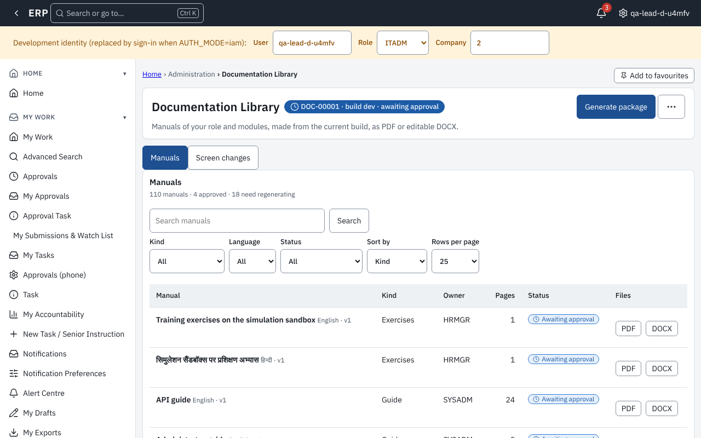
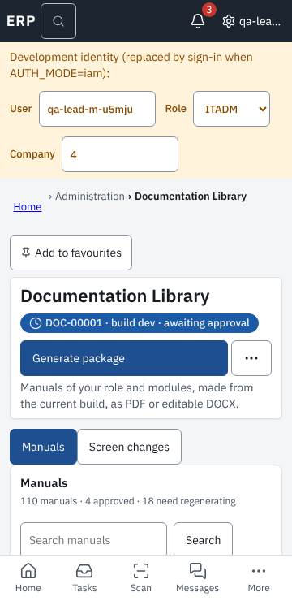

# Part 30.09 — User Manuals & Documentation Package

Execution step 227 · 2026-11-23 · Branch `ccr-a3b3ce3d-65llwf` · **Ready for review**: built and tested behind `ff.qa.p3009`. The real module owners approve the package of the release build during UAT (D-816).

## 1. Discovery

Help & Support (29.08), the page registry, the role templates, the workflow types, the page descriptions of the migration tracker and the PDF renderer of 04.11 existed. There was no manual, no DOCX writer, no screen capture of the build and no drift check. See the [discovery note](../DISCOVERY/30.09.md).

## 2. What was built

**Made from the build (BR-01).** A manual can only describe what the build registers:

- pages: route, English and Hindi label (the menu's label from the navigation table), permission, flag;
- roles: the pages each role can open, its department, scope, responsibilities and authority;
- workflows: every workflow type, its default chain, the step names and SLA hours;
- the description of each page from the migration tracker;
- the screens as captured: title, tabs, actions, form labels, headings, columns.

**The package** (`src/server/modules/tst/manuals.js`) holds 110 manuals:

| Kind | Count | Contents |
|---|---|---|
| Role manual | 44 roles + Hindi for the 9 field roles = 53 | Your role; signing in; your pages and tasks by module, with steps read from the screen; approvals you take part in (document, chain, your step, SLA); screens (phone size for field roles); FAQs |
| Module guide | 30 | Every page with what it is for and the roles that open it; steps and screens; the module's workflows step by step; FAQs |
| Guide | 7 | Administrator; installation and start-up (from the environments and deploy runbooks); API (every operation of the OpenAPI files); data import; reports and exports; security (secrets, rotation, certificates); backup, restore and recovery |
| Quick reference card | 18 | The 9 field roles in English and Hindi: daily tasks in two steps, working offline, help |
| Exercises | 2 | The simulation sandbox packs of 30.04, English and Hindi |

**Formats.** Each manual is rendered twice:

- as PDF by the 04.11 renderer (IBM Plex Sans with Devanagari, images, page header and footer). Two renderer fixes were needed: ordered lists are now numbered, and a small JPEG is copied before pdf-lib reads it (it used to read Node's shared buffer pool from offset 0);
- as an editable DOCX written as WordprocessingML (`tst/docwriter.js`): Word heading styles (navigation pane, table of contents), numbered steps restarting per list, tables with header rows, embedded images, page-number footer.

One ZIP holds README, `manifest.json` (build, capture, every file with its SHA-256, owner and version) and `pdf/` and `docx/`. A full package of 110 manuals without images took 31 s and 11.8 MB (lab machine). It is generated as a background job with progress.

**FR-03 Drift check.**

1. `e2e/tst-manual-screens.spec.js` opens every registered page: desktop, plus phone size for the pages field roles open.
2. It reads each screen's signature and uploads a JPEG to the document service (04.10), linked to the capture (virus-scanned; a file not yet cleared is left out of a manual).
3. The capture is compared with the accepted baseline. A screen is CHANGED (with the item-by-item difference), NEW or REMOVED; the order of items does not count.
4. Every current manual that shows such a route — or, for a module guide, a new screen of its module — becomes STALE with the reason, and the writers are notified.
5. The writer accepts the capture as the new baseline and generates the package again.

**Approval (AC-01, ADR-770).**

- The writer (ITADM) submits the drafts. Each manual goes to its owner through the approval engine:
  - module guide → the module's owner (the 30.03 owner map);
  - role manual → the head of the role's department;
  - guides → SYSADM;
  - quick cards and exercises → HRMGR.
- Owners approve or reject many at once on the page; a rejection needs a comment.
- A manual whose content did not change since its approved version keeps that approval in the next package. The package is APPROVED when all its manuals are.

**Page: Documentation Library** (`/help/documentation`, list report)

- Search; parameters (kind, language, status, sort, 25/50/100 rows) in a bottom sheet on a phone.
- Status chips, PDF and DOCX per manual; multi-select with Approve n / Reject n for the owner; Send n drafts for the writer.
- Export of the list (XLSX, CSV, PDF, honouring the filters and what the person may see); download of the ZIP (view_all).
- Sticky total; cards on a phone; "Generate package" as the primary action with progress while the job runs.
- **Screen changes** tab: the last capture against the baseline, changed screens with their differences, compare and accept.

**Who sees what.** Everyone (the Help gate) reads:

- the manuals and cards of their roles;
- the guides of the modules they open;
- the exercises;
- what they own.

`man.manual.view_all` (ITADM, SYSADM, AUD, module owners) reads every manual and the ZIP. Another role's manual is 404.

## 3. Tests

| Test | Result |
|---|---|
| `tests/man-manuals.test.js` (6): signatures normalised and compared item by item; **T-01** a changed, a new and a removed screen flagged against the baseline, the two module guides showing them stale with the reason, an unregistered route refused (BR-01), only an open capture takes screens; **AC-01** a package of 7 manuals as PDF and DOCX in one ZIP with manifest, screenshots uploaded through the document service and embedded, the steps read from the screen, every page the SE manual opens is a page SE can open (BR-01), Hindi manual and card, API and recovery guides; approvals by each owner (not the writer, not another owner), rejection with a comment, re-submission, an unchanged manual keeps its approval in the next package; **AC-03** visibility by role, 404 for another role's manual, 403 for the ZIP, generate and capture; export honours visibility; flag off → 404; markdown and OpenAPI sources | pass |
| `e2e/tst-golive-docs.spec.js` (desktop and mobile): generate on the page, submit, an owner approves several at once, a field user sees only their manuals, the screen-change tab shows the changed action | see §6 |
| `e2e/tst-manual-screens.spec.js`: the capture of the build | see §6 |
| Full package of 110 manuals generated (script run, 31 s) | pass |
| lint, typecheck (0 errors), route check, permission audit, migration check, schema-diff, db-lint, `tests/api.test.js` | pass |

## 4. Acceptance criteria

| Criterion | Status | Evidence |
|---|---|---|
| AC-01 ZIP (PDF + DOCX) from the current build, approved by module owners | Partly | Generated and approved through the application (tests and e2e); the real owners approve the release package during UAT (D-816). |
| AC-02 page completion checklist | Met | No placeholder; every figure from the API; empty, error and no-permission states. |
| AC-03 roles | Met | §2 "Who sees what", `tests/man-manuals.test.js`. |
| AC-04 configuration audited and maker-checker | Met | Captures, packages, submissions, decisions and downloads audited; manuals approved by another person. |
| AC-05 tests and regression | Met | §3 and the regression of this batch. |
| AC-06 this report | Met | |
| AC-07 UI v3 and phone | Met | Screenshots below; no sideways scroll at 360 px; cards; bottom sheet; 125 % text in dark and high-contrast. |
| AC-08 owned defects | Met | D-803 re-assigned to 30.10 with its reason; new D-816. |

## 5. Data changes

- Migration `20261228000426_man_manuals`: `man_captures`, `man_screens`, `man_packages`, `man_manuals`; three templates; navigation entry and tracker row.
- Permissions `man.manual.view_all`, `man.manual.generate`, `man.manual.export` (ADR-770).
- File entity `man_captures`.

## 6. Screenshots

## 7. How to verify manually

1. Turn on `ff.qa.p3009`.
2. Run the capture: `MAN_ACCEPT=1 MAN_PACKAGE=1 npx playwright test e2e/tst-manual-screens.spec.js --project=desktop`.
3. Open **Help › Documentation Library** as ITADM: the package and its manuals; download a PDF and its DOCX; download the ZIP from "…".
4. Send the drafts. Sign in as PD: select the manuals waiting and approve them.
5. Change a page, capture again: the **Screen changes** tab lists the screen, and the manuals that show it are "Screens changed".
