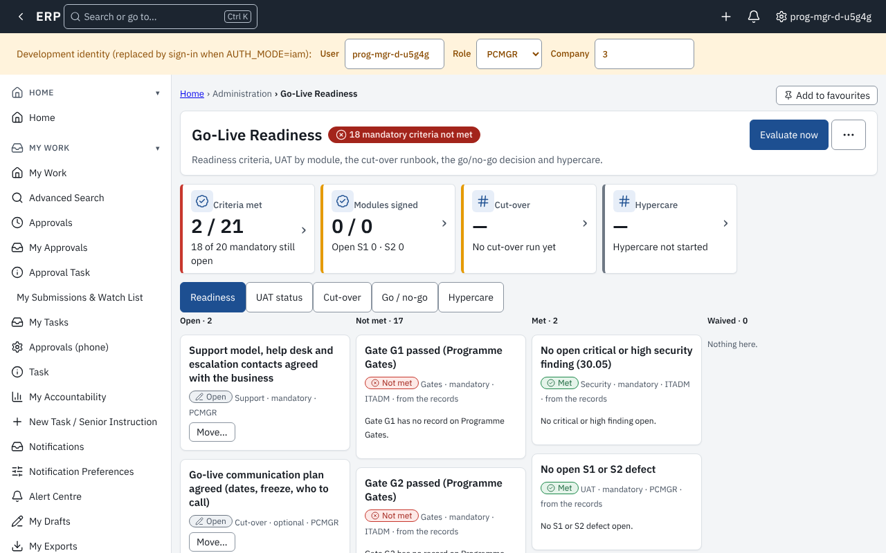
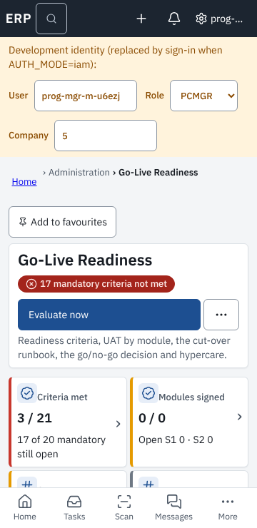

# Part 30.10 — UAT, Production Cut-over & Hypercare

Execution step 228 · 2026-11-23 · Branch `ccr-a3b3ce3d-65llwf` · **Ready for review**: built and tested behind `ff.qa.p3010`.

What is not done here (D-818): the go-live itself is the customer's event — UAT by the business users, the production cut-over, hypercare and handover. The readiness checklist of this build says **not ready**: gates G5–G7 cannot be recorded (D-817), and UAT, training and the documentation approval need the real users.

## 1. Discovery

Reused (none rebuilt; see the [discovery note](../DISCOVERY/30.10.md)):

- Programme Gates;
- the data-migration cockpit and its freeze;
- backups and the approved restore;
- deployment, runbooks and on-call (30.08);
- the security, performance, accessibility and documentation records (30.05–30.09);
- HR training;
- the workflow types.

New: UAT scripts, defects and sign-off; the readiness checklist; the cut-over runbook; the go/no-go decision; hypercare.

## 2. What was built (`src/server/modules/tst/golive.js`)

**FR-01 UAT**

- **Scripts** come from the build's scenarios:
  - one per approval workflow: create, submit, approve along its default chain, return once, check the history;
  - up to six per module for its main pages and the roles that open them.
- **Running scripts:** business users run them (every internal role holds `uat.execute`). A failure raises a defect (S1–S4).
- **Daily triage** (module owners, ITADM, PCMGR):
  - owner and severity;
  - fixed in a commit (it reaches production only through the pipeline, 30.08);
  - re-tested and closed by the reporter;
  - or deferred with a reason (never an S1).
- **Sign-off:** a module is signed by its owner through the approval engine, only when every script passed and no S1/S2 is open. Its scripts are locked meanwhile.

**FR-02 Readiness** — nineteen criteria:

| Criterion | Evaluated from |
|---|---|
| Gates G1–G7 passed | Programme Gates |
| No open critical/high security finding | 30.05 |
| Latest load test meets its SLOs | 30.06 |
| Verified backup ≤ 26 h and restore test ≤ 30 days | 29.06 |
| Every runbook approved; L1–L3 on call for 28 days | 30.08 |
| Accessibility signed off | 30.07 |
| Documentation package approved | 30.09 |
| Training ≥ 90 % of active users (`golive.training.course_codes`) | HR training |
| UAT signed for every module; no open S1/S2 | this part |
| Migration objects signed off | 29.05 |
| A dry run inside its window | this part |
| Support model agreed; communication plan | by hand, with evidence |

- A mandatory criterion cannot be waived.
- The board shows the criteria in four columns (open, not met, met, waived) with the detail of each.

**FR-03 T-01 Cut-over runbook** — nine steps with owners and minutes. Six run themselves:

1. announce the freeze;
2. rollback point = a verified full backup (29.06);
3. *(by hand, ITADM)* freeze the legacy system and take the final extracts;
4. final data migration (29.05 objects loaded; in a dry run, signed off);
5. configuration and environment parity (30.08);
6. smoke test (database check, failed jobs);
7. *(by hand, PCMGR)* business owners check key figures against the legacy reports;
8. users active with roles;
9. lift the freeze and announce.

How a run behaves:

- A run records its elapsed time and whether it finished inside its window.
- A failed step fails the run; it is rolled back to its rollback point (the restore itself is the approved restore of 29.06).
- The production run needs an approved GO (BR-01).

**FR-04 BR-01 Go/no-go**

- The meeting record holds the attendees, the minutes, the recommendation, the go-live date and the criteria as they stood.
- It is approved PCMGR → CFO → DIR, never by its author.
- A GO is refused while a mandatory criterion is not met, and checked again at the director's approval.
- An approved GO announces the date to every user (in-app and e-mail).

**FR-05 Hypercare**

- Opens when the production run completes (or by hand after an approved GO), for four weeks by default.
- War room roles.
- Daily report built at 18:00 IST:
  - defects opened and closed, and open by severity;
  - alerts, failed jobs, help-desk tickets opened and open;
  - active users, deployments.
- The war room publishes it with triage notes (notified).
- Handover to steady-state support:
  - only after the period;
  - only with no S1/S2 open;
  - approved by the director.

**Page: Go-Live Readiness** (`/admin/go-live`, board)

- **Status:** ready or not.
- **Key figures:** criteria met, modules signed with open S1/S2, the cut-over run, hypercare.
- **Tabs:**
  - readiness board — four columns on a desktop; on a phone one column with pills, and a criterion moved through its menu;
  - UAT status — chart by module with drill-down, modules and sign-off, scripts with run and fail-with-defect, defects with triage;
  - cut-over — plan, start, the timeline of steps with their owners;
  - go/no-go — the meeting form and the approval;
  - hypercare — the daily reports and publishing.
- **Exports:** checklist, UAT status and hypercare report as XLSX, CSV or PDF.

## 3. Tests

| Test | Result |
|---|---|
| `tests/golive.test.js` **T-01**: a dry run plans nine steps (one run at a time; production refused without GO); the automatic steps run, the rollback point is a verified backup, the owners complete their steps (another role is refused), the run completes inside its 60-minute window and the DRY_RUN criterion is met; a failed step fails the run and it is rolled back | pass |
| **FR-01**: more than 50 scripts generated from the build, idempotent. Procurement scripts run; a failure needs and raises an S2 defect. Sign-off refused while not passed / S2 open. Triage: owner, a deferral needs a reason, a fix needs a commit, only the reporter closes. The owner signs (not the programme manager); scripts locked; the event published | pass |
| **FR-02 BR-01**: the nineteen criteria. G1 met from Programme Gates, G6 "no record". Training measured (2 trained users of the active ones). A manual criterion needs evidence and its owner; a mandatory one cannot be waived, an optional one can with a reason; an automatic one cannot be set. GO refused naming GATE_G5 | pass |
| **FR-04 FR-05**: ITADM cannot submit. A NO-GO goes PCMGR (another person) → CFO → DIR, not out of order, not by its author. Given a GO, hypercare runs four weeks. A hypercare defect HC-…; the day's figures; publishing by the war room once. Handover refused before the end and with an S2 open, then approved by the director. The production cut-over can be planned | pass |
| **AC-03**: AUD views; SE runs scripts but not the console; exports by kind; flag off → 404 | pass |
| `e2e/tst-golive-readiness.spec.js` (desktop and mobile): the board (four columns / one with pills); a criterion moved with evidence; scripts generated; a business user's failure and its triage; the dry run completed on the page by ITADM and PCMGR; a NO-GO approved along the chain | see §6 |
| lint, typecheck (0 errors), route check, permission audit, migration check, schema-diff, db-lint, `tests/api.test.js`, `tests/config-core.test.js` | pass |

## 4. Acceptance criteria

| Criterion | Status | Evidence |
|---|---|---|
| AC-01 UAT signed, go-live per runbook, hypercare handed over | Not met here | The customer's event (D-818). Every step is built and rehearsed (§3). The checklist says not ready: G5–G7 (D-817). |
| AC-02 page completion checklist | Met | No placeholder; every figure from the API; empty, error and no-permission states. |
| AC-03 roles | Met | `tests/golive.test.js`. |
| AC-04 no approval bypass | Met | Sign-off, decision and handover only through the approval engine. The production run needs the approved GO. A mandatory criterion cannot be waived. Every write is audited. |
| AC-05 tests and regression | Met | §3 and the regression of this batch. |
| AC-06 this report | Met | |
| AC-07 UI v3 and phone | Met | Screenshots below. |
| AC-08 owned defects | Met | 59 re-assigned to the steady-state backlog with their reasons (production environment and providers; people; enhancements); new D-817, D-818. |

## 5. Data changes

- Migration `20261228000427_golive`: nine tables (see DB_CHANGES).
- Parameters: `golive.training.min_pct` (90), `golive.training.course_codes` (ERP-USER), `golive.hypercare.weeks` (4), `golive.cutover.window_minutes` (720).
- Permissions `golive.view`, `golive.manage`, `golive.export`, `uat.execute`, `uat.triage` (ADR-771).

## 6. Screenshots

## 7. How to verify manually

1. Turn on `ff.qa.p3010`. Sign in as PCMGR and open **Admin › Go-Live Readiness**. Evaluate: each criterion shows what the records say.
2. **UAT status**: generate the scripts. As a business user, run one and fail it with a defect. Triage it.
3. **Cut-over**: plan and start a dry run. Complete the manual steps as ITADM and PCMGR. It completes inside its window.
4. **Go / no-go**: record the meeting; approve it as another PCMGR, the CFO and the director. A GO is refused until every mandatory criterion is met.
